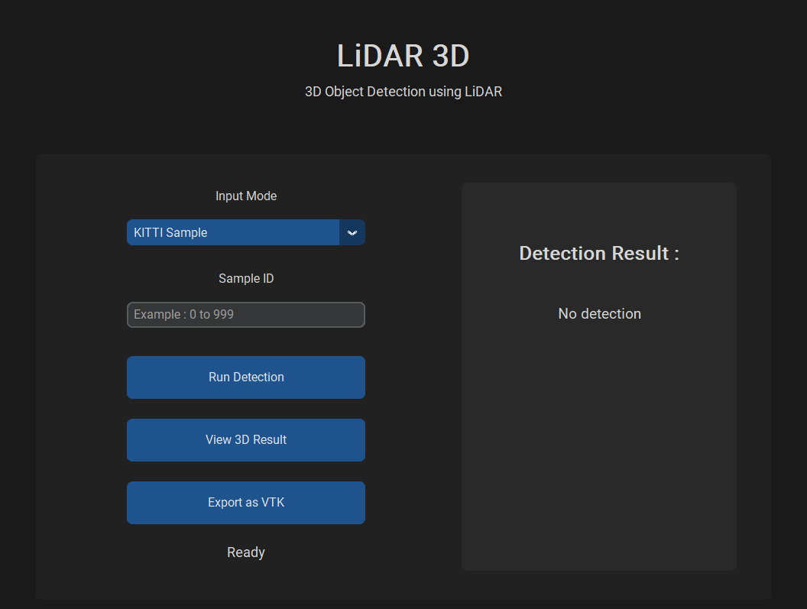
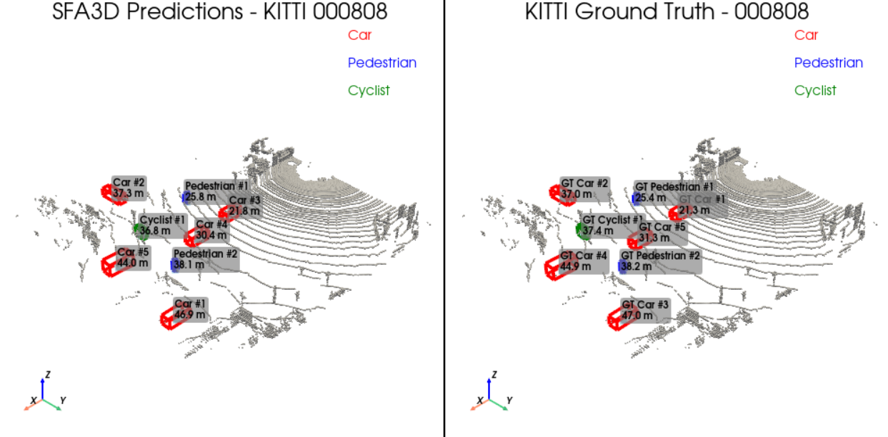

# LiDAR3D
### 3D Object Detection and Localization Using LiDAR

LiDAR3D is a Windows desktop application for LiDAR-based 3D object detection, point-cloud visualization, and localization.

Built upon the **SFA3D** detection framework, the application integrates model inference with a graphical user interface and tools for inspecting and evaluating 3D detection results.

## Features

- **LiDAR point-cloud input:** Support for `.bin` point-cloud files.
- **3D object detection:** Detection using the SFA3D framework.
- **3D visualization:** Inspect point clouds and 3D bounding boxes.
- **Ground-truth comparison:** Compare predictions with available ground-truth annotations.
- **VTK export:** Export supported results for external 3D visualization.
- **Evaluation results:** Store evaluation results in CSV format.
- **Desktop interface:** GUI built with CustomTkinter.

## Screenshots

Add screenshots of the actual application here.

<!-- Example:

-->

## Technology Stack

- Python
- PyTorch
- SFA3D
- CustomTkinter
- NumPy
- OpenCV
- VTK

Verify the dependencies against the actual implementation.

## Model and Attribution

This project builds upon **SFA3D (Super Fast and Accurate 3D Object Detection)**.

Original repository:
https://github.com/maudzung/SFA3D

The original detection framework is credited to its authors.
LiDAR3D provides an application-level integration with a desktop
interface and additional visualization and evaluation workflows.

Please refer to the original repository and its license for
the applicable attribution and licensing requirements.

## Dataset

This project supports workflows involving the KITTI dataset.

Official KITTI website:
https://www.cvlibs.net/datasets/kitti/

The dataset is not included in this repository. Users must obtain
the data and comply with the dataset's applicable terms.

## Installation

Installation instructions depend on the Python, PyTorch, CUDA,
and model-checkpoint versions used by the project.

See the project documentation for the tested environment,
dependency installation, and model setup.

## Usage

1. Launch the LiDAR3D application.
2. Select a supported LiDAR `.bin` file or dataset sample.
3. Run 3D object detection.
4. Inspect the point cloud and predicted 3D bounding boxes.
5. Compare predictions with available ground-truth annotations.
6. Export supported visualization results to VTK.
7. Review evaluation results in `Output/evaluation_results.csv`,
   if generated by the selected workflow.

## Evaluation

Evaluation results are provided in:

`Output/evaluation_results.csv`

The evaluation methodology, dataset split, number of evaluated
frames, and metric definitions should be documented alongside
the reported results.

Custom evaluation results should not be interpreted as official
KITTI benchmark scores unless the official evaluation protocol
has been followed.

## Requirements

- Windows
- A compatible Python environment
- Compatible PyTorch and CUDA versions for GPU inference
- Required model checkpoint files
- Appropriate input data and annotations for the selected workflow

Refer to the installation documentation for exact version requirements.

## Limitations

- Detection performance depends on the model and input data.
- Custom point clouds may require compatible formatting.
- Ground-truth comparison requires suitable annotations and,
  where applicable, calibration files.
- Runtime and GPU compatibility depend on the installed environment.

## License and Third-Party Notices

See the SFA3D license and the third-party notices included
with this repository.

The licensing terms of the original framework, model weights,
datasets, and other dependencies may differ.

## Acknowledgments

Thanks to the authors of SFA3D and the contributors to the
KITTI dataset.
